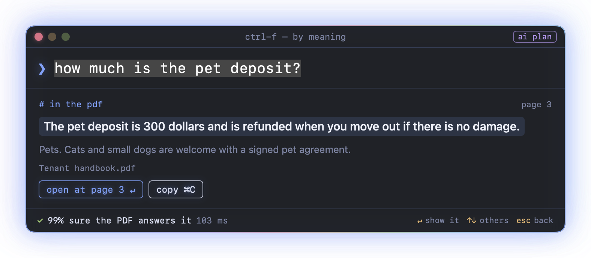

# Pareto for Mac

A search bar for your whole Mac, in the same terminal look as the [Chrome extension](https://github.com/zohane112/pareto-chrome). Press **⌥ Space** in any app:

- **Open apps:** `open slack`, `calc`, or "I want to do some maths" (Calculator).
- **Find files:** `find my tax pdf from march` or `show me my screenshots`. It uses Spotlight's index, so it finds files by name and by what's inside them.
- **Ask about the window in front:** "when is rent due?" while a PDF is open in Preview, or "what does this page say about refunds?" in Chrome, Mail or Notes. It shows the sentence that answers, and **show it** takes you there. A PDF opens at the right page with the answer highlighted. With a Nebius key, NVIDIA Nemotron 3 Super also writes a short answer above the sentence.
- **Think harder:** **⌘ ↵** on the window, a PDF, or an answer has NVIDIA Nemotron 3 Ultra read all of it, reason it through, and answer questions that need the whole document, like "what does living here cost besides the rent?". It points to the passages it used.
- **Pictures:** scanned PDFs and picture files (PNG, JPG, HEIC and others) are read with Apple's Vision, on the Mac. With screen reading allowed (macOS 14 or later), a picture of the front window is read when its own text has no answer, for text drawn as a picture, like in Figma. The picture isn't kept.
- **Voice:** hold ⌥ Space, speak, and let go. Or use Wispr Flow in the bar. Either way it runs when you stop talking.
- **Web:** `go to youtube.com` opens the site, and `search the web for …` searches Google.
- **Sums:** `12*4.5`, `(3+4)/2` or `15% of 80` show the answer; Enter copies it.
- **Recents:** the empty bar lists what you opened through it lately.

Meaning comes from [Jev](https://docs.typesafe.ai) from TypeSafe AI first, because it's the fastest: it works out which app or file you mean in about 0.1 s. NVIDIA Nemotron, served by Nebius Token Factory, does the rest, the same way as in the Chrome extension:

| Job | Model |
| --- | --- |
| Which app or file you mean, and where the answer is, when there's no Jev key or Jev can't (out of funds, key refused, busy, too slow, an error, or text too long for Jev) | **Nemotron 3.5 Lightning**, reasoning off |
| The exact sentence, when Lightning found the passage | Lightning |
| The short written answer above the sentence | **Nemotron 3 Super**, reasoning off |
| Think harder (⌘ ↵) | **Nemotron 3 Ultra**, reasoning on, streamed: the status line shows `nemotron 3 ultra · thinking · 1,240 words` |

When Lightning stands in for Jev, the status line says why, such as `Lightning · 640 ms · Jev out of funds`. The code is `Sources/Nemotron.swift`, and the README at the top of the project explains the design.



More: [opening an app from plain English](docs/open-app.png), [the empty bar](docs/empty.png), and [settings](docs/settings.png). Test results are in [TESTS.md](TESTS.md).

## Install

The download opens as a window with the app, an arrow to Applications, and **READ ME FIRST**, a three-page guide with pictures. It covers installing, the plans, pasting a Jev key, allowing window reading, and what the app can and can't do. The guide's source is `dmg/READ ME FIRST.html`.

1. Open `dist/Pareto-<version>.dmg` and drag **Pareto** onto **Applications**.
2. Double-click it in Applications. If macOS says it can't open the app, click **Done**, then open **System Settings › Privacy & Security**, scroll down, and click **Open Anyway**. macOS asks this once, because the app isn't notarized yet. On macOS 15 and later, right-click › Open no longer skips this.
3. The welcome window opens.
   - Pick **Free** or **AI plan**. The AI plan needs a Jev key, a Nebius key, or both. Each is kept in your Keychain.
     - **Jev:** click **get a key ↗** under **jev key**, make a key at [console.typesafe.ai/keys](https://console.typesafe.ai/keys), paste it, and click **save**.
     - **Nebius (Nemotron):** click **get a key ↗** under **nebius key**, make a key at [tokenfactory.nebius.com](https://tokenfactory.nebius.com/), paste it, and click **save**. It checks the key and lists Lightning ✓ Super ✓ Ultra ✓. Then switch on **Zero Data Retention** in your Nebius account profile.
   - Click **allow it** to let it read the window in front, under Privacy & Security › Accessibility. That's only needed for questions about what's on screen.

A magnifier appears in the menu bar. Its menu has **Settings…** and **Quit**.

## Keys

| Key | What it does |
| --- | --- |
| **⌥ Space** | Open or close the bar. Change it in Settings. |
| **Hold ⌥ Space** | Speak; let go to run it. |
| **↵** | Open the selected app or file, or ask the window. On an answer, **show it**. |
| **↑ ↓** | Choose a result, or step through answers. |
| **⇥** (Tab) on a PDF | Ask the question about that PDF without opening it. |
| **⌘ ↵** | On the window, a PDF or an answer: think harder with Nemotron 3 Ultra (needs a Nebius key). On a file or app: show it in Finder. |
| **⌘ C** on an answer | Copy the sentence, or Ultra's answer when it didn't point to a passage. |
| **esc** | Back from an answer, or close the bar. |

**Speaking or pasting** a request runs it by itself when that can't surprise you: a sum, a question about the window, an app named outright, or a pick Jev is sure about. Anything else waits for Enter.

## Plans

| | Free | AI plan |
| --- | --- | --- |
| Apps and files by name | ✓ | ✓ |
| Exact words in the window in front | ✓ | ✓ |
| Plain-English requests ("the pdf about my taxes") | | ✓ |
| Answers from the window in front, PDFs too | | ✓ |
| A written answer, and think harder (with a Nebius key) | | ✓ |
| What leaves the Mac | nothing | what you ask and the text being searched, to Jev and to Nebius only |

## Privacy

- It reads the window in front only when you ask about it, and never keeps what it read.
- It never reads password fields.
- Voice uses Apple's speech recognition on the Mac when the Mac supports it. It listens only while you hold the shortcut.
- The Jev and Nebius keys are kept in the macOS Keychain.
- Nebius keeps what it's sent unless **Zero Data Retention** is switched on for the account.

## Build it

It needs only Apple's Command Line Tools, not Xcode.

```bash
./build.sh
```

That builds `build/Pareto.app` (one app for Apple silicon and Intel), signs it ad hoc, and packs `dist/Pareto-<version>.dmg`. Use `./build.sh --dev` for a quick build for this Mac only.

The download's window is made by `dmg/`:
- `dmg/make.sh` uses Chrome to draw `background.html` into the window's background (normal and Retina) and to print `READ ME FIRST.html` to a PDF with the version filled in.
- `dmg/settings.py` tells [dmgbuild](https://pypi.org/project/dmgbuild/) where each icon goes. The first build installs dmgbuild into `build/venv`, not system-wide, so it needs the internet once.
- The two pictures of the welcome window in the guide are `dmg/welcome-key.png` and `dmg/welcome-allow.png`. Retake them if the welcome window changes.

### Checks

```bash
"build/Pareto.app/Contents/MacOS/Pareto" --selftest
```

- **With `--jev`:** add a real key in `CTRLF_JEV_KEY` to run the Jev checks. They're 12 plain-English requests and a PDF question. The key is never printed.
- **`--nemotron`:** the Nemotron paths with the key in `CTRLF_NEBIUS_KEY`: the key check, finding (Jev first, Lightning standing in), the sentence, Super's answer, Ultra thinking harder, the bar's own search and ⌘ ↵ on a PDF, and routing. `CTRLF_NO_JEV=1` hides a saved Jev key so Lightning does the finding. To run it with no Nebius key and nothing spent, start the stand-in server with `node tests/mock-tokenfactory.mjs` and add `CTRLF_NEBIUS_KEY=mock-key CTRLF_NEBIUS_BASE=http://127.0.0.1:8765/v1`.
- **`--render <folder>`:** draws the bar's screens to images.
- **`--route "…"` and `--pdf file.pdf "question"`:** try one request. `--pdf` takes a picture file too.
- **`--ocr picture.png`:** the blocks of text Vision finds, and the same file read as a one-page PDF.
- **`--screen "App Name"`:** a picture of that app's window, read the same way. It needs Screen Recording; run from Claude's shell, it borrows the shell's permission.
- **Links:** `ctrlf-meaning://open?q=…` opens the bar with that text in it. It never runs anything by itself, because any web page can offer a link.
- **Test links:** started with `CTRLF_TEST=1`, the app also takes these, for the checks:
  - `ask?path=/file.pdf&q=…`
  - `type?q=…`
  - `enter`
  - `show`
  - `snapshot?path=/tmp/bar.png` (add `&window=settings` or `&window=pdf` for those windows)
  - `askpicture?q=…`: asks the picture of the front window only, skipping its text
- **To picture the welcome window as a new user sees it,** start the app with `open --env CTRLF_TEST=1 -a …`, not from the shell, so it doesn't borrow the shell's permissions. Delete its saved settings afterwards: `defaults delete com.ctrlf-by-meaning.mac`.

## Files

```
Sources/
  main.swift          starts the app, or the checks
  AppDelegate.swift   menu bar icon, shortcut (tap or hold), the bar and settings windows
  SearchModel.swift   what the bar does: rows, reading a request, answers, written answers, think harder
  SearchView.swift    the bar's look
  SettingsView.swift  settings and the welcome window
  Finder.swift        apps (Applications folders) and files (Spotlight)
  WindowReader.swift  reading the window in front (Accessibility) and PDFs (PDFKit)
  Overlay.swift       the glow over an answer, and the PDF viewer
  Jev.swift           the Jev API: questions, retries, line search
  Nemotron.swift      NVIDIA Nemotron on Nebius Token Factory (Lightning, Super, Ultra) and Jev-first routing
  TextTools.swift     sentences, passages, keywords
  Voice.swift         hold-to-talk with Apple's speech recognition
  HotKey.swift        the global shortcut
  Theme.swift         colours, fonts, the terminal frame
  SelfTest.swift      the checks above
build.sh              build, sign, icon, .dmg
Info.plist.in         the app's settings for macOS
dmg/                  the download's window and the READ ME FIRST guide
```

## Not done yet

- **Notarization:** Apple's Developer ID, $99 a year. With it, a download opens without the Open Anyway step.
- **Very long pages:** reading the front window stops after 4 seconds, so the end of a very long web page can be missed.
- **Checks that need someone at the Mac:**
  - Reading other apps' windows through Accessibility, including PDFs open in Chrome and pictures open in Preview.
  - The microphone, which needs a person to speak.
  - "Move and Open" when the app is opened straight from the download.
  - These code paths are written and guarded, but only a real run proves them.

## Signing

`signing.sh` makes the app's own signing certificate once, in `~/Library/Application Support/CtrlFByMeaning/signing` (outside the project, so it's never zipped or shared), and `build.sh` signs with it. macOS remembers the Accessibility and Screen Recording switches by that certificate, so updates keep them. Losing that folder means one more round of permission switches for everyone who updates.

## Licence

The code is under the [MIT licence](LICENSE). The bundled fonts (Geist, Geist Mono and DSEG7) keep their own SIL Open Font Licence; the licence texts sit next to the fonts.
